# Greenhook Architecture & Hooking Internals

Greenhook attaches to an **unmodified stock Longshot `v3.0.0`** build (`bin\longshot.exe` and `bin\longshot_vk.dll`) by exploiting two properties of the stock build:
1. `bin\longshot.exe` imports `WINMM.dll` (not a Windows KnownDLL) and calls `timeBeginPeriod(1)` on `MainThread` right after `hos_mods_init()` and before guest boot or Vulkan renderer startup (`hos_display_start()`).
2. Both stock PE32+ binaries (`longshot.exe` and `longshot_vk.dll`) retain full unstripped COFF symbol & string tables.

---

## High-Level Boot & Runtime Flow

```mermaid
flowchart LR
    A["bin/longshot.exe boots"] --> B["Windows loads bin/winmm.dll proxy"]
    B --> C["DllMain loads System32/winmm.dll & resolves 180 procs"]
    C --> D["MainThread calls timeBeginPeriod(1)"]
    D --> E["InitOnce outside loader lock loads plugins/*.asi & calls InitializeASI()"]
    E --> F["longshot_js.asi resolves 65 COFF symbols from longshot.exe"]
    F --> G["Installs 29 MinHook detours + starts QuickJS-NG + named pipe server"]
    G --> H["hos_display_start() -> hk_load_vulkan() loads longshot_vk.dll"]
    H --> I["hooks_vk.cpp resolves 73 COFF symbols & installs 6 VK + 2 MkwVkHost hooks"]
```

---

## 1. Universal Proxy ASI Loader (`asi/winmm_loader.c` & `asi/gen_winmm_proxy.py`)

- At build time, `asi/gen_winmm_proxy.py` parses `%SystemRoot%\System32\winmm.dll`'s PE32+ export table directly and generates:
  - `winmm_exports.inc` (`WINMM_STUB_COUNT = 180` `{ordinal, name}` entries skipping `timeBeginPeriod`).
  - `winmm_stubs.S` (180 tiny x86-64 `jmp *(%rax)` jump thunks indexing `g_winmm_procs[i]`).
  - `winmm.def` (exports every symbol at its **exact original ordinal**, mapping `timeBeginPeriod` to `proxy_timeBeginPeriod`).
- At process attach, `DllMain` avoids loading plugins inside the OS loader lock. It only resolves `System32\winmm.dll` and populates `g_winmm_procs[]`.
- When `MainThread` invokes `timeBeginPeriod(1)`, `proxy_timeBeginPeriod` executes `InitOnceExecuteOnce`:
  - Aborts early if `LONGSHOT_JS_DISABLE=1` or the host process basename is not `longshot.exe`.
  - Scans `<exe_dir>\plugins\*.asi` and `<parent_dir>\plugins\*.asi` sorted case-insensitively.
  - Calls `LoadLibraryW` and invokes the plugin's exported `InitializeASI()` outside loader lock, then delegates cleanly to `System32\winmm.dll`'s real `timeBeginPeriod`.

---

## 2. PE COFF Runtime Symbol Resolver (`asi/coff_sym.c`)

Because stock `longshot.exe` and `longshot_vk.dll` are LLVM-MinGW binaries built with COFF symbols embedded in the PE file:
- `coff_resolve_batch(HMODULE mod, CoffSymReq *reqs, size_t count)` maps the backing binary file read-only (`MapViewOfFile`) using `GetModuleFileNameW(mod, ...)`.
- Reads `IMAGE_FILE_HEADER.PointerToSymbolTable` / `NumberOfSymbols` and the trailing string table.
- Walks 18-byte `CoffSymRec` records (`IMAGE_SYM_CLASS_EXTERNAL` and `IMAGE_SYM_CLASS_STATIC`, skipping auxiliary symbols).
- Computes live ASLR-adjusted addresses directly from `(uintptr_t)mod + Section[SectionNumber - 1].VirtualAddress + sym.Value`.
- Resolves **65 symbols** in `longshot.exe` (`asi/host_bridge.c`) and **73 symbols** in `longshot_vk.dll` (`asi/hooks_vk.cpp`) in a single linear scan at startup.

---

## 3. Host Hooks on `longshot.exe` (`asi/hooks_exe.c`)

`asi_hooks_exe_install()` attaches **29 MinHook detours** across every subsystem of `longshot.exe`:

| Subsystem | Hooked Stock Targets | Purpose in Greenhook |
| :--- | :--- | :--- |
| **Runtime & Frames** | `a64_lookup`, `hos_close_finish`, `hos_vi_native_presented` | Dispatches dynamic `native.createCallback` guest pointers (`[0xFF00000000...]`), tears down pipe/JS runtime on exit, applies text/camera speed scales, and pumps `game.onFrame` + timers/promises on each presented frame. |
| **OoT Gameplay** | `hos_oot_lift_player`, `hos_oot_hearts_enabled`, `hos_oot_cct_speed`, `hos_oot_damage`, `hos_oot_fov`, `hos_oot_free_view`, `hos_mouse_camera`, `hos_oot_text_pane`, `hos_oot_menu_tick`, `hos_oot_menu_focus`, `hos_oot_trace_save`, `hos_oot_opening` | Fires `onPlayerUpdate`, `onDamage` (customizable hit/cancel), `onCameraUpdate`, mouse camera overrides & centering disable, `onMenuTick`, `onMenuFocus`, `onSaveRequest` (cancellable), `onEventRequest`, and `onTimelineStart` (cancellable), plus runtime player/text/FOV multipliers. |
| **Options, Audio & HID** | `rx_option`, `apply` (`nn_audio`), `npad_states` | Live overrides for `HOS_OPT_CHEAT_FLIGHT` & `HOS_OPT_VOLUME` (mute/scale), audio pitch scaling (`OP_VOICE_PITCH`), controller reading/mutating/blocking via `onInput` and `game.input.setOverride`, and automatic muting of game inputs while `F9` console has focus. |
| **Virtual RomFS & Redirects** | `host_path`, `hle__ZN2nn2fs8OpenFile...`, `ReadFile` (3 overloads), `GetFileSize`, `CloseFile`, `GetEntryType` | Implements in-memory virtual RomFS files via synthetic handle tag `0x70000000 \| slot` and file path redirects without modifying `romfs/`. Uses `_Thread_local tls_in_host_path` around `rom_rel()` inside `hk_fs_host_path` because `rom_rel()` itself calls `host_path()`. |
| **Windowing & Renderer** | `wndproc`, `menus_mouse`, `load_vulkan` | Handles `WM_APP + 13` to unlock cursor/mouse interaction for interactive JS windows & `F9` console, injects `VK_UP`/`VK_DOWN` console command history keys, and detects `longshot_vk.dll` loading in `hk_load_vulkan`. |

### Dynamic `native.hook` vs Stock `a64_lookup`
In ASI mode (`-DLONGSHOT_ASI`), hooking an existing AArch64 lifted function (via `native.hook(addr, { before, after })`) calls `a64_lookup(addr)` to find the compiled x86-64 host function pointer and detours it directly with **MinHook** into one of 128 static trampolines (`g_tramps[128]`), leaving `a64_lookup()` completely unburdened for normal JIT/lifted table lookups while scoping `a64_js_lookup_hook` strictly to synthetic JS callbacks (`native.createCallback`). Note that `MH_CreateHook`/`MH_EnableHook`/`MH_RemoveHook` execute strictly **outside** `g_hook_lock` (`SRWLOCK`) to prevent lock-order inversions when hooks fire.

---

## 4. Vulkan Renderer & Dear ImGui `1.92.9b` Hooks (`asi/hooks_vk.cpp`)

When `hk_load_vulkan` sees `longshot_vk.dll` load, `asi_hooks_vk_attach()` resolves **73 Itanium-mangled symbols** matching exact `ImGui 1.92.9b` + `mkwvk::*` symbols compiled by the same `llvm-mingw` ABI:
- **Detours**: `mkwvk::menu_tick`, `menu_record`, `menu_record_image`, `ui::begin`, `ui::record`, and `ui::record_to`.
- **Win64 ABI Interop**: Both `longshot_vk.dll` and `hooks_vk.cpp` are compiled with `llvm-mingw` Clang C++20 against matching `third_party/imgui/imgui.h` (`ImVec2` packed in `RAX`; `ImVec4` returned via hidden `sret` pointer in `RCX`).
- **`vk_host` Read-Only Placement**: In stock `longshot.exe`, `vk_host` lives in `.rdata` (read-only). Rather than mutating `.rdata` page protections, `hooks_vk.cpp` installs two MinHook detours directly on `host->take_text` and `host->take_key_press` on first `menu_tick` so typing or pressing `Esc` in the `F9` console suppresses pass-through to the emulator's hotkey/menu handlers cleanly.
- **Snapshot-Based Rendering**: `hooks_vk.cpp` pulls an immutable double-buffered `MkwVkJsSnapshot` (`hos_js_ui_snapshot_vk`) from `host/js_ui.c` on the render thread and pushes user widget clicks, slider drags, checkboxes, `F9`/`F8` state changes, and REPL commands asynchronously back through `hos_js_ui_event_vk`.

---

## 5. QuickJS-NG Core & Thread Synchronization (`host/js_*.c`)

- **Runtime Lock (`CRITICAL_SECTION g_js_cs`)**: QuickJS runtimes are single-threaded per VM (`JS_UpdateStackTop` called on every `js_enter()`). All JS evaluations, module loads, hook callbacks, timers, and pipe RPC commands acquire `g_js_cs` cleanly.
- **UI & Engine Locks (`SRWLOCK`)**: Read-mostly UI snapshots (`g_ui_lock`), script/log metadata (`g_meta_lock`, `g_log_lock`), RomFS overrides (`g_rom_lock`), and native hooks (`g_hook_lock`) use fast shared/exclusive `SRWLOCK`s.
- **Lock-Free Hot Path**: Fast atomics guard `hos_js_player_invincible()`, `hos_js_player_speed_scale()`, `hos_js_damage_multiplier()`, `hos_js_fov_scale()`, `hos_js_camera_speed_scale()`, audio scales/mute, and listener presence flags (`js_has_event_listeners`) so disabled or unused hooks add negligible overhead per frame.
- **Static-Linked Standalone Deployment**: `plugins/longshot_js.asi` links statically (`-static`) against `libc++` and `libunwind` so it requires **zero non-Windows DLLs** in `<GameDir>\bin\`.
